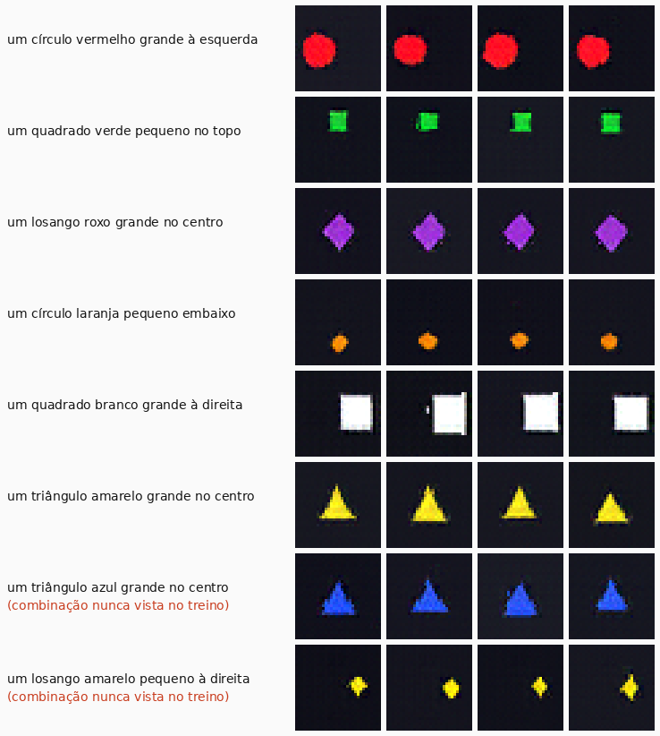

# MiniT2I

Um gerador de imagens por texto de 2.666.800 parâmetros, treinado do zero,
rodando inteiro no navegador. Você escreve o prompt, a rede parte do ruído puro
e limpa a imagem passo a passo no seu processador, quatro imagens por vez, no
estilo do Midjourney.

A página está em **[samuelpedroso-dev.github.io/minit2i](https://samuelpedroso-dev.github.io/minit2i/)**.
Tudo que aparece lá é calculado no seu navegador. Não existe servidor de
inferência.

Esta é a versão 0.1, e ela é pequena de propósito. O modelo só conhece formas
geométricas em 32 por 32. O objetivo desta etapa é provar a arquitetura inteira,
do treino à página, com medição honesta, antes de escalar. **O repositório vai
receber atualizações**, a próxima já com fotos reais, e o roteiro está no fim
deste arquivo.



---

## O que roda no navegador

Os pesos chegam em float16 codificados em base64, 7,1 MB no total. Um
encoder de texto de duas camadas lê o prompt, e um Diffusion Transformer de seis
blocos, com atenção cruzada ao texto e modulação adaptativa pelo tempo, prevê a
cada passo para onde a imagem deve andar. A conta é a mesma do PyTorch,
reescrita em JavaScript puro, sem biblioteca nenhuma.

Cada uma das quatro imagens roda num Web Worker separado, um por núcleo. O que
aparece na tela durante a geração é a estimativa da rede para a imagem final
naquele passo, então a imagem vai se formando enquanto o modelo decide.

O motor JavaScript foi conferido contra o PyTorch num caso de referência, com a
mesma entrada e o mesmo prompt.

| conferência | resultado |
|---|---|
| tokenização | idêntica à do Python |
| erro máximo na saída da rede | 1,6e-03 para valores de até 6,0 |
| tempo por passo, um núcleo | cerca de 211 ms em Node |

Esse erro é o arredondamento do float16, e prova equivalência numérica entre as
duas implementações, nada além disso.

Além de gerar do zero, a página faz variações. Ela pega uma imagem pronta,
mistura com 60 por cento de ruído e deixa a rede refazer a partir dali, o que
mantém a composição e muda os detalhes.

---

## A arquitetura

| peça | o que é |
|---|---|
| encoder de texto | embedding próprio, 2 camadas de transformer, 128 dimensões, treinado junto com o resto |
| gerador | Diffusion Transformer, 6 blocos, 4 cabeças, patches de 4 por 4, atenção cruzada ao texto, adaLN Zero |
| objetivo | rectified flow, a rede prevê a velocidade entre ruído e imagem, tempo sorteado em logit normal como no Stable Diffusion 3 |
| guidance | 10 por cento dos exemplos de treino sem prompt, para o classifier free guidance |
| amostragem | Euler, 30 passos por padrão |
| pesos | média móvel exponencial dos pesos de treino, decaimento 0,999 |

Nenhum peso pré treinado foi usado, nem no texto nem na imagem.

---

## O treino

8.616 passos de AdamW com lotes de 64, em 2 núcleos de CPU, sem GPU, em pouco
mais de uma hora. O dataset tem 20 mil imagens sintéticas de formas com
legenda em português, como "um triângulo amarelo grande no centro", geradas
pelo `treino/formas.py`.

Duas combinações foram retiradas do treino de propósito, **triângulo azul** e
**losango amarelo**. A rede viu triângulos e viu azul, mas nunca os dois juntos.
Elas servem para medir se o modelo combina conceitos ou só decora imagens.

---

## A medição

Todas as 280 combinações de forma, cor, tamanho e posição, duas sementes cada,
30 passos e guidance 4. Um classificador geométrico lê cada imagem gerada. A cor
sai da média dos pixels do objeto, o tamanho e a posição saem da caixa que
envolve o objeto, e a forma sai da comparação da opacidade de cada pixel com a
silhueta ideal das quatro formas, na mesma área e no mesmo centro de massa.

Antes de medir o modelo, o classificador foi medido em 2.000 imagens reais do
treino, onde a resposta certa é conhecida. Ele acertou 99,9% dos atributos
completos. Sem essa conferência, a tabela abaixo mediria o classificador, não a
rede.

| atributo | combinações vistas, 520 imagens | nunca vistas, 40 imagens |
|---|---|---|
| Cor | 100,0% | 100,0% |
| Tamanho | 98,5% | 100,0% |
| Posição | 100,0% | 100,0% |
| Forma | 98,9% | 100,0% |
| Tudo certo ao mesmo tempo | 97,3% | 100,0% |

Nas combinações vistas, 506 de 520 imagens acertam os quatro atributos ao mesmo tempo. Os 14 erros se dividem entre tamanho e forma, quase todos em formas pequenas, onde um objeto ocupa poucos pixels e a diferença entre um círculo e um losango é de um ou dois pixels.

Nas combinações nunca vistas, as 40 imagens acertaram tudo. É o resultado mais interessante da tabela e também o de amostra menor, então ele mostra que a rede generaliza nesse caso, não que generaliza sempre. Num domínio tão simples, juntar cor e forma é muito mais fácil do que juntar conceitos em fotos reais, e é isso que as próximas versões vão medir.

---

## O que isso não é

Isto não é um gerador geral. Ele não sabe desenhar um gato, uma pessoa ou uma
paisagem, e palavras fora do vocabulário são ignoradas, a página mostra quais
foram riscadas. O que esta versão prova é que a cadeia inteira funciona, do
encoder de texto ao transformer, do treino ao navegador, com a mesma arquitetura
usada pelos geradores grandes, numa escala que cabe numa CPU.

---

## Próximas atualizações

| versão | o que entra |
|---|---|
| **0.1** | formas geométricas em 32 por 32, tudo treinado do zero em CPU. Publicada |
| 0.2 | gerador geral, qualquer prompt em português ou inglês. Um transformer de 120 milhões de parâmetros treinado do zero no espaço latente do VAE do Stable Diffusion, com um encoder de texto CLIP multilíngue congelado, em 2,9 milhões de fotos do CC3M a 128 por 128, no Colab gratuito. Em treino, código em `geral/` e `colab/geral.ipynb` |
| 0.3 | 256 por 256, legendas melhores e mais dados, treino em várias GPUs gratuitas ao mesmo tempo com DiLoCo |
| 1.0 | um gerador geral, no nível dos primeiros geradores públicos, rodando no seu computador |

Cada versão segue a mesma regra desta. O modelo roda inteiro no navegador, o
JavaScript é conferido contra o PyTorch e cada número vem medido.

---

## Como reproduzir

```
pip install -r requirements.txt
cd treino
python3 treinar.py --minutos 9      # repita, ele retoma do checkpoint
python3 gerar.py "um quadrado roxo grande no topo"
python3 medir.py ckpt.pt
cd ..
python3 web/exportar.py treino/ckpt.pt
node web/conferir.mjs
python3 web/montar.py
python3 -m http.server              # e abra localhost:8000
```

---

## Mapa do repositório

| caminho | o que é |
|---|---|
| `index.html` | a página, montada por `web/montar.py` |
| `pesos.b64.txt` | pesos em float16, base64 |
| `modelo.json` | configuração, vocabulário, mapa dos tensores e caso de referência |
| `modelo/minit2i.pt` | checkpoint do PyTorch, pesos da média móvel |
| `web/` | motor de inferência, worker, interface e scripts de exportação e montagem |
| `treino/` | modelo, dataset, treino, geração e medição em PyTorch |
| `geral/` | o gerador geral da versão 0.2, modelo, preparo do dataset e treino |
| `colab/geral.ipynb` | notebook que prepara os dados e treina o gerador geral no Colab |
| `colab/treino.ipynb` | treino das formas em GPU |
| `resultados/` | medição, conferência do motor e grade de exemplos |
