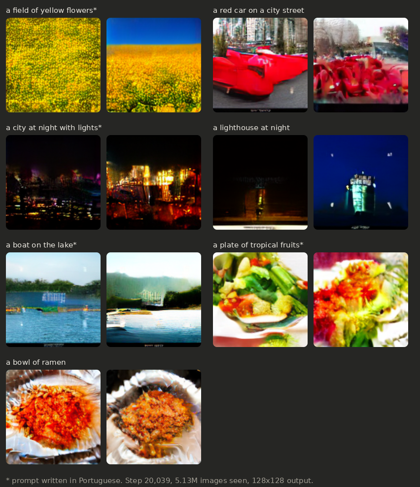
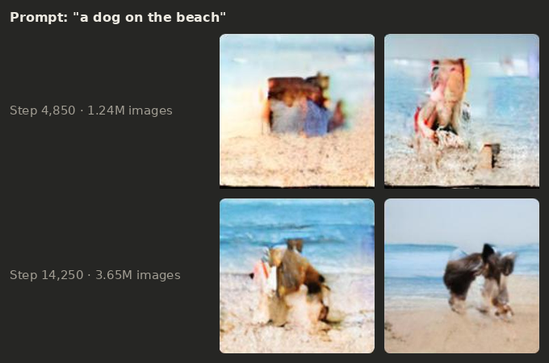

<div align="center">

# MiniT2I

**A text to image Diffusion Transformer trained from scratch on free GPUs, running entirely in your browser.**

[](https://samuelpedroso-dev.github.io/minit2i/)
[](https://samuelpedroso-dev.github.io/minit2i/painel.html)




</div>

## Overview

MiniT2I is a 120 million parameter Diffusion Transformer that I am training from zero, with no pretrained generator weights, on captioned photos from CC3M (2.9 million in the full set, about 720,000 distinct photos prepared so far). The generator is the part trained from scratch. It works on top of two pretrained models that stay frozen, a multilingual CLIP text encoder and the Stable Diffusion VAE, which give it the meaning of the prompt and the compressed image space. Training runs on the free tier of Google Colab, switching between accounts whenever a session ends, and every checkpoint is published automatically to the web page.

Inference happens in the browser. You type a prompt in English or Portuguese, the page downloads the model once, and your own graphics card turns random noise into four 128 by 128 images through WebGPU. There is no inference server.

**The model is still training and this repository will keep receiving updates.** The page always serves the latest checkpoint, so it improves on its own every 30 minutes of training.

## Current status

| | |
|---|---|
| Training step | 25,300 |
| Images seen | 6.48 million of a 15 million target, about 43% (these are exposures, photos are revisited) |
| Distinct photos in the training pool | about 720,000, growing as preprocessing continues |
| Training loss (rectified flow) | 0.877, down from 0.90 at 2 million images |
| Throughput | about 105 images per second on one Tesla T4 |
| Remaining compute | about 22 GPU hours |

Live numbers, real training photos and the activity of each transformer block are on the [training dashboard](https://samuelpedroso-dev.github.io/minit2i/painel.html).

## What changed with more training



**At 1.2 million images** the model already understood scenes and colors. Beaches had sand, sea and sky in the right places, but the dog was only a smudge.

**At 3.6 million images** objects started to appear. The same prompt now produces an actual dog standing on the sand, with fur, body and legs, still blurry and melted at the edges.

**At 5 million images**, in the grid at the top, the model handles natural scenes very well. The yellow flower field has a horizon, sky and trees, and the night city has the right mood of dark buildings and colored lights. It also binds attributes to objects, so "a red car on a city street" gives a red car with a city behind it.

**What still fails.** Objects with a precise shape come out distorted or disappear, like the boat and the lighthouse. Specific food is weak, and the ramen looks nothing like ramen. Several images carry a strip of fake text at the bottom, learned from the watermarks and captions on stock photos in CC3M. Everything is soft, partly because of the 128 pixel resolution.

Object shape is what improves most with more training. Sharpness and the fake text will not go away on their own, they need the data and resolution changes planned for the next version.

## How it works

| part | details |
|---|---|
| Generator | Diffusion Transformer, 12 blocks, width 768, 12 heads, patch size 2, about 120M parameters, trained from scratch |
| Conditioning | cross attention to text tokens plus a pooled text vector, shared adaLN modulation in the style of PixArt, RMS normalized queries and keys for float16 stability |
| Text encoder | frozen multilingual CLIP (`clip-ViT-B-32-multilingual-v1`), so prompts work in English and Portuguese |
| Latent space | frozen Stable Diffusion VAE (`sd-vae-ft-ema`), 128 px images become 16 x 16 x 4 latents |
| Objective | rectified flow with logit normal timesteps, classifier free guidance with 10% empty prompts |
| Sampling | Euler, 25 to 30 steps, guidance 4 to 4.5 |
| Training | fp16 autocast on a free T4, batch 256 with gradient accumulation, EMA 0.9999, the whole latent dataset kept in GPU memory |
| Browser | ONNX Runtime Web on WebGPU, transformer and VAE in fp16, text encoder quantized to int8, a WordPiece tokenizer rewritten in JavaScript |

Each checkpoint is exported to ONNX and uploaded to Hugging Face by the training loop itself. The page reads `meta.json`, uses the model already cached in the browser and fetches the new version in the background.

## Version 0.1, the shapes model

Before scaling, I proved the whole chain on a tiny 2.7 million parameter model that draws colored geometric shapes at 32 x 32, trained on CPU only and running in plain JavaScript with no libraries. Two shape and color combinations were held out of training to test whether the model composes concepts.

| attribute | seen combinations, 520 images | never seen, 40 images |
|---|---|---|
| Color | 100.0% | 100.0% |
| Size | 98.5% | 100.0% |
| Position | 100.0% | 100.0% |
| Shape | 98.9% | 100.0% |
| All correct at once | 97.3% | 100.0% |

The classifier used for this measurement was checked first on 2,000 real training images, where it got 99.9% of attributes right. The JavaScript engine matches PyTorch to within float16 rounding. That model is still available on the page under the shapes option.

## Roadmap

| version | scope |
|---|---|
| 0.1 | geometric shapes at 32 x 32, trained on CPU. Released |
| **0.2** | general model, any prompt, 128 x 128, 15 million images on free T4s. **Training now** |
| 0.3 | controlled experiments, one change at a time, see the plan below |
| 0.4 | a larger transformer of 300 to 400 million parameters on CC12M |

## Plan for 0.3

The bottleneck right now is probably not the size of the transformer but the quality of what it learns from. So 0.3 is a series of controlled experiments instead of one big change. Every experiment starts from the same frozen 0.2 checkpoint, trains the same number of steps on the same shards and changes one thing.

| id | change | status |
|---|---|---|
| E0 | baseline, same steps and data as the others | ready |
| E1 | detailed captions from Florence 2, mixed with the originals, which are kept untouched | ready |
| E2 | data cleaning by CLIP zero shot scores (watermark, text, blur) and sharpness | ready |
| E3 | aspect ratio buckets instead of center crop | needs non square support in the model |
| E4 | timestep distribution. 0.2 already samples logit normal, E4 mixes in uniform so the ends are not neglected | ready |
| E5 | best combination of the above | after E1 to E4 |
| E6 | fine tuning at 256 x 256 from the 128 checkpoint, the weights do not depend on resolution | after E5 |

Each one is scored with `geral/avaliar.py` on a fixed, categorized prompt set (objects, animals, people, scenes, attribute binding, counting, spatial relations, Portuguese) with fixed seeds. It reports CLIP score with a CLIP model different from the one used in training, and FID against 5,000 held out CC3M validation photos. `geral/cego.py` builds an offline page for blind human A/B voting between two experiments. A larger model only comes after the data side is solved. The notebook is `colab/experimentos.ipynb`.

On cost, 256 x 256 means 256 image tokens instead of 64. Self attention grows 16 times, but at this size most of the compute is in the linear layers, which grow 4 times, so a step costs roughly 4 to 5 times more.

## Run it yourself

Open the [live page](https://samuelpedroso-dev.github.io/minit2i/) in a recent Chrome or Edge with WebGPU. The first visit downloads about 480 MB, later visits load from the browser cache.

To train, open `colab/geral.ipynb` in Google Colab with a T4 GPU and run all cells. With an `HF_TOKEN` secret, checkpoints and the web model go to Hugging Face, and without it they stay in Google Drive. If the session ends, run it again and it resumes from the last checkpoint.

```
pip install -r requirements.txt
python geral/gerar.py "a lighthouse at night"     # generate locally from the latest checkpoint
python web/montar.py                              # rebuild index.html
python -m http.server                             # then open localhost:8000
```

## Repository map

| path | contents |
|---|---|
| `index.html` | the generator page, built by `web/montar.py` |
| `painel.html` | live training dashboard |
| `geral/` | general model, data preparation, training loop, ONNX export and the live dashboard feed |
| `colab/` | notebooks for training and testing on Colab |
| `web/` | browser engines for both models, interface and build scripts |
| `treino/` | the 0.1 shapes model, dataset, training and measurement |
| `resultados/` | result grids and measurements |

## License

The code is MIT, see [LICENSE](LICENSE). The license does not cover the training data. CC3M photos belong to their owners and are only referenced through the public dataset, never redistributed here.

Built by [Samuel Pedroso](https://github.com/Samuelpedroso-dev).
